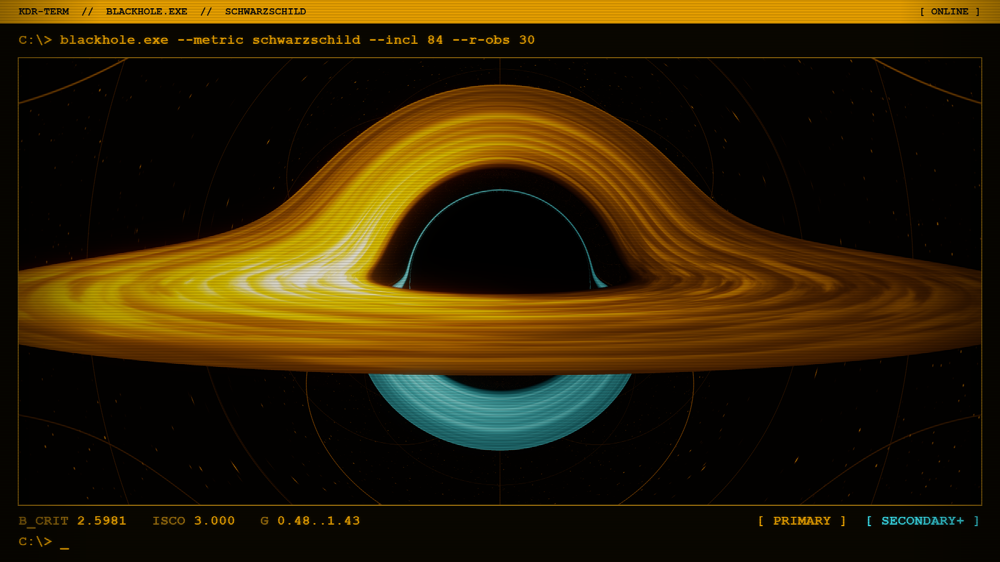
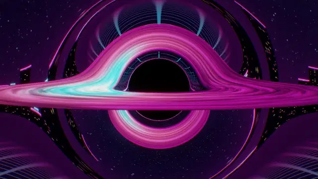
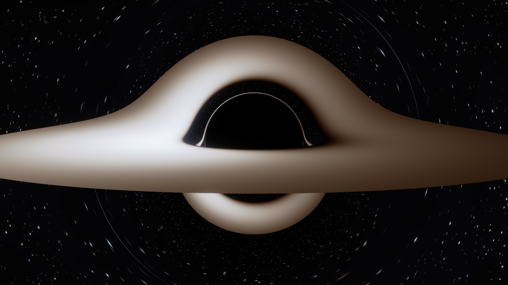

# blackhole



A Schwarzschild ray tracer in Python and GLSL. Camera rays follow null geodesics through their turning points, hit a thin accretion disk, escape to a background sky, or cross the horizon. The disk has a zero-torque temperature profile and relativistic Doppler beaming. The default `terminal` style draws it as a single amber phosphor inside a retro CRT window: brightness follows the observed bolometric intensity, images formed after the first equatorial crossing are drawn in cyan, and the sky is a celestial coordinate grid so the lensing of escaped rays stays visible. The readout under the image (critical impact parameter, ISCO radius, range of the redshift factor `g` on the primary image) is computed from the traced rays.



[Download the 1280x720 MP4](assets/blackhole_loop.mp4). The camera oscillates slowly and a differentially rotating disk texture cross-fades periodically. The 720x405 inline preview is about 1.1 MB; the full loop is five seconds at 30 fps.

## Physics model

Units are `G = c = 1`, `r_s = 2M = 1`. The disk is in the equatorial plane, between the Schwarzschild ISCO at `r_in = 3 r_s` and `r_out = 14 r_s`. A static pinhole observer sits at `r_obs = 30 r_s`; inclination is measured from the disk normal.

### Ray paths

Spherical symmetry confines each photon to the orbital plane spanned by its initial radial vector and direction. Within that plane, the Binet equation is

```text
u = 1/r
u'' = -u + (3/2) r_s u^2
```

RK4 integrates `(u, du/dphi)`, not a signed square root of the radial equation. At periapsis `du/dphi` changes sign naturally, so rays continue outwards. The step is limited by both `dphi <= 0.03` and a bound on the change in `u`; this is a step-size heuristic, not an error-controlled adaptive solver. Cubic Hermite interpolation locates disk crossings within a step. Crossings are found analytically from the orbital plane, including subsequent half-orbits. A ray stops at the first disk crossing inside its emitting annulus, at the horizon, or at `u = 0` (infinity).

For the camera's local ray angle `alpha` from the inward radial direction,

```text
b = r_obs sin(alpha) / sqrt(1 - r_s/r_obs)
r_photon = 1.5 r_s
b_critical = (3 sqrt(3)/2) r_s = 2.598076... r_s
sin(alpha_shadow) = b_critical sqrt(1 - r_s/r_obs) / r_obs
```

The finite observer correction matters when converting an image radius into an impact parameter. The displayed dark region is partly covered by foreground disk emission; shadow validation therefore disables the disk and measures the capture mask, not the RGB image.

### Disk emission and beaming

The emitted flux uses the spin-zero Page-Thorne profile, up to a normalization:

```text
x = sqrt(r/M), x0 = sqrt(6)
F(r) proportional to [x - x0 + (sqrt(3)/2) ln((x+sqrt(3))(x0-sqrt(3)) /
                                         ((x-sqrt(3))(x0+sqrt(3))))]
                    / [(x^2 - 3) x^5]
T_emit proportional to F^(1/4)
```

It vanishes at the ISCO and approaches `r^-3` in flux, or `r^-3/4` in temperature, far from the hole. Gas moves on prograde circular geodesics with `Omega = sqrt(M/r^3)`. If `lambda = L_z/E` is the physical photon's conserved axial angular momentum per unit energy, the shift to a static observer is

```text
g = nu_obs/nu_emit
  = sqrt(1 - 3M/r) / [(1 - Omega lambda) sqrt(1 - r_s/r_obs)]
T_obs = g T_emit
I_obs,bolometric = g^4 I_emit,bolometric
```

The physical photon travels opposite to the backwards-traced camera ray, so the sign of `L_z` is reversed in the tracer. The approaching side is brighter and shifted to higher frequencies. Lensing changes solid angle through the ray map; no extra magnification multiplier is applied to surface brightness.

## Physical model vs artistic choices

| Included in the model | Presentation choices |
| --- | --- |
| Schwarzschild null geodesics, capture and escape | Amber phosphor ramp (terminal) or neon palette indexed by `g T_emit` (cyberpunk) |
| Primary, secondary and further equatorial crossings | Cyan coloring of secondary and higher images; celestial grid, skyline and floor grid backgrounds |
| Keplerian orbital velocity and gravitational/Doppler shift | Periodic sheared noise and radial texture lanes |
| Zero-torque thin-disk flux profile | Terminal window frame, Gaussian bloom, chromatic aberration, scanlines and vignette |
| Bolometric `g^4` intensity factor | Exposure, tone mapping and nonlinear intensity compression in the stylized modes |

`--style physical` uses the same rays and redshift, a smooth disk and an approximate blackbody RGB fit instead of the neon palette. It is not calibrated spectral photometry: the peak temperature and flux normalization are arbitrary, and a single RGB color approximates a spectrum. For display, the terminal style compresses `g^4 F` with a power of `0.55` and the cyberpunk style with `0.6`; both modulate it with a periodic disk texture. Neither mode includes spin, disk thickness, absorption, scattering, returning radiation, polarization, time-of-flight differences or fluid dynamics. The disk is opaque and emits isotropically in its rest frame. The background is a direction-only sky at infinity, not a city near the hole. Motion is a periodic presentation loop, not a time-dependent disk simulation.

<details>
<summary>Blackbody-colored view</summary>



</details>

## Validation

Measured with `python validate.py` on an AMD Radeon 780M, OpenGL 4.3. The shadow run uses a 1024x1024 image with no disk. The disk run uses 1920x1080, inclination 84 degrees and a 28-degree vertical field of view, with one center sample per pixel. Measurements use ray metadata before styling or post-processing.

| Check | Result |
| --- | --- |
| Shadow radius in image, theory / measured equivalent area | 318.786 / 318.793 px |
| Shadow angular radius, theory / measured | 4.88447 / 4.88458 degrees |
| Recovered impact radius / theoretical `b_critical` | 2.59813 / 2.59808 `r_s` (0.0022% difference) |
| GPU vs NumPy classification, 192x108 rays | 20,736 / 20,736 agree |
| GPU vs NumPy disk crossing order | 100% agreement |
| Median / 99th-percentile absolute difference in `g` | 1.27e-7 / 8.81e-7 |
| Primary disk mean bolometric intensity, left / right | 0.67011 / 0.17080, ratio 3.92 |
| Mean `g` on primary image, left / right | 1.08918 / 0.80285 |
| Primary / secondary / further disk image pixels | 609,096 / 58,300 / 102 |
| Unresolved rays in shadow and disk checks | 0 |

Left is the approaching side for this camera and rotation convention. The large arch above the shadow includes the far side of the primary disk image; the smaller arch below it is the secondary image. Image order is the index of the equatorial crossing that meets the disk, starting at zero. The tests also bracket capture at `b_critical (1 +/- 1e-4)`, preserve the circular photon orbit and check large-impact-parameter deflection against `2 r_s/b` and its second-order correction. At `b = 1000 r_s`, the measured deflection is 1.00148 times the leading weak-field prediction. A separate test checks the closed-form flux against numerical evaluation of the Page-Thorne integral.

The subpixel shadow agreement is an area average, not a claim of subpixel accuracy for every boundary ray. Very narrow higher-order images can remain undersampled. The NumPy and GLSL implementations share an algorithm, so agreement between them is a port check, not independent proof of the model. Analytic limits and the flux-integral test provide separate checks.

## Run

Python 3.10+ and an OpenGL 4.3 driver are required for the GPU renderer. No window is opened. FFmpeg is needed only for MP4/WebP output.

```bash
pip install -r requirements.txt
python render.py --out blackhole.png
python render.py --style physical --out physical.png
python render.py --style cyberpunk --out neon.png

# Five-second loop and a small inline preview
python render.py --width 1280 --height 720 --ss 2 --fov 24 --frames 150 --fps 30 \
  --out loop.mp4 --webp loop.webp --webp-width 720 --webp-quality 70

# Disable presentation effects or change the geometry
python render.py --inclination 75 --r-obs 40 --fov 24 \
  --no-bloom --no-chromatic --no-scanlines --out clean.png

pip install pytest
python -m pytest -q -rs
python validate.py
```

With `uv`, installation can be temporary:

```bash
uv run --with moderngl --with numpy --with pillow python render.py
uv run --with moderngl --with numpy --with pillow --with pytest python -m pytest -q
```

`--ss` is the supersampling factor per axis, default 2. The hero uses `--ss 3 --fov 24`. `--sway` controls periodic camera motion; `--time` selects a still's disk-texture phase; `--exposure` fixes exposure explicitly. See `python render.py --help` for all options. Animation uses fixed exposure from the first frame, endpoint-matched camera motion and a smooth periodic cross-fade of two sheared texture layers. The last encoded frame precedes the first by one frame interval; no duplicate endpoint frame is stored. The renderer refuses output if rays exhaust the integration budget.

The vectorized CPU reference is `blackhole/physics.py`. It returns status, emission radius, redshift, crossing order and escaped direction for a batch of rays. It needs only NumPy and does not open an OpenGL context. `tests/test_physics.py` exercises it on CPU; GPU tests skip when no suitable context is available, but shader compilation failures are test failures. The full styled CLI uses the GPU.

### Timing

The 150-frame 1280x720 terminal loop at 2x supersampling rendered in 207.0 s, or 212.1 s including MP4 and WebP encoding. On the Radeon 780M, the 1920x1080 terminal hero (`--ss 3 --fov 24`) traced in 0.55 s and took 4.26 s for post-processing, framing and PNG output. A 1280x720 physical still at 3x took 0.17 s plus 1.02 s. These are single warm-driver measurements, not a benchmark suite. Compute dispatches are tiled and synchronized; post-processing is NumPy FFT blur and image filtering. The low-resolution NumPy reference check took about 0.10 s for 20,736 rays.

## Interactive thin-lens demo

`python main.py` is the original GLFW demo, retained separately. It applies a point-mass thin-lens map to a procedural starfield for up to eight lenses. It does not use the Schwarzschild tracer above.

| Key | Action |
| --- | --- |
| N / M | Single-lens / multi-lens mode |
| Arrow keys | Move the active lens |
| C | Cycle the active lens |
| Q / E | Decrease / increase its Einstein radius |
| + / - | Add / remove a lens, up to eight |
| T / G | Scale the background up / down |
| S | Save `screenshot.png` |
| Esc | Quit |

## Layout

```text
render.py                   still and animation CLI
validate.py                 numerical measurements
blackhole/
  physics.py                vectorized NumPy reference, disk flux and redshift
  gpu.py                    headless ModernGL host and camera configuration
  post.py                   bloom, tone mapping and display effects
  frame.py                  terminal window frame and readout for the terminal style
shaders/
  raytrace.comp             per-pixel camera and compute entry point
  geodesic.glsl             ray integration, crossings and redshift
  style.glsl                disk palette, texture and background
  lensing.comp              separate interactive thin-lens shader
  quad.vert, quad.frag      interactive fullscreen quad
main.py                     original GLFW thin-lens demo
tests/                      analytic limits, GPU/reference and image-processing checks
assets/                     curated PNGs, MP4 and animated WebP
```

The earlier inward-only geodesic scripts and their compute shader have been replaced. They stopped at turning points and could not form an escaping-ray image.

## References

- [Page and Thorne (1974), Disk-Accretion onto a Black Hole](https://articles.adsabs.harvard.edu/pdf/1974ApJ...191..499P): thin-disk flux and circular orbits.
- [Luminet (1979), Image of a spherical black hole with thin accretion disk](https://ui.adsabs.harvard.edu/abs/1979A%26A....75..228L/abstract): disk images and relativistic appearance.
- [Narkowicz (2016), ACES Filmic Tone Mapping Curve](https://knarkowicz.wordpress.com/2016/01/06/aces-filmic-tone-mapping-curve/): display tone curve, not part of the spacetime model.

## License

MIT, see [LICENSE](LICENSE).
